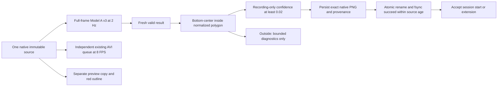
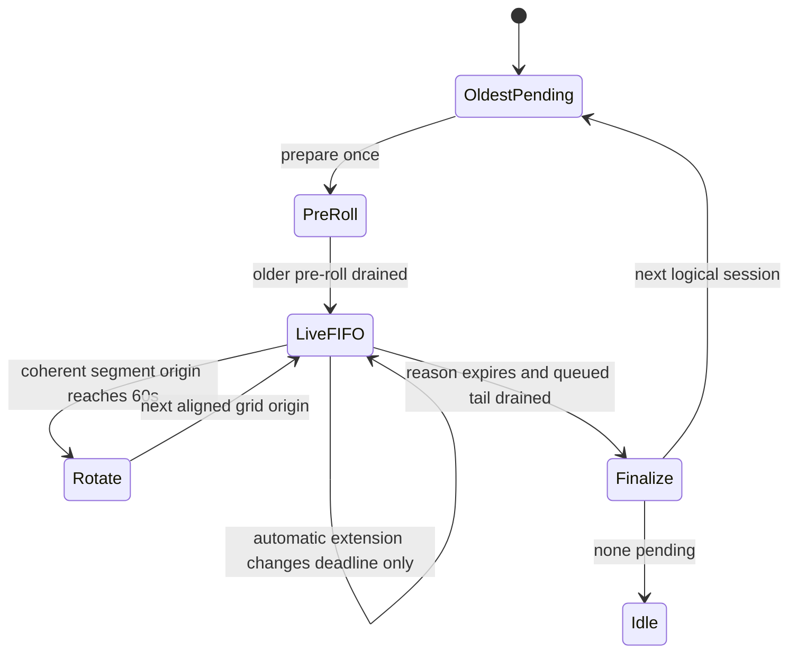

1. **Unintended Squirrel Squirter processes before?** None found. PID 6555 was the sole application and camera owner. Legacy service was inactive/MainPID=0; no stale collector, Flask, Jupyter, benchmark, standalone validation, or legacy model application was found. The short audit Python process is explicitly separate from the application.

2. **What runs afterward?** One normal collector service, squirrel-collector-phase4-6.service, PID 8311 at the final audit, running the corrected source. Both validation processes have exited. The service name is retained; it now loads Phase 4.7 code.

3. **Exactly one collector/camera owner?** Yes at final audit: root-visible fuser reports only 8311 on /dev/video0. No GPIO/I2C descriptors were found. No legacy/control workload was started.

4. **Final normalized polygon?** The 55-vertex polygon printed below, version current-garden-owner-2026-09-08-v1, SHA-256 323c1d832a99a0d684e72d8dfd5ceb1903c006a56a4aded4fd189df9a63d3e79. The exact vertex count is also shown with the coordinate artifact below.

5. **Matches the owner drawing?** Visually yes: compared the actual deployed preview against the supplied drawing. Top/background and right-edge exclusions match; foreground stays inside; the accidental left rectangular notch is replaced by the smooth outer contour. Screenshot supplied for owner review, not a claim of subsequent owner approval.

6. **Recurring right-edge patch outside?** Yes. Replaying the retained native box coordinates through the new bottom-center test excludes all 287/287 historical observations. No model inference or labeling was performed for this check.

7. **Outside detections stop automatic recording?** They cannot start or extend it. Existing manual reasons and an already accepted automatic tail continue normally. Outside observations remain in bounded diagnostics and do not set the valid-trip indicator. Actual injected outside detections did not start recording; one natural outside result was also ignored in the normal run.

8. **Every qualifying trip guaranteed exact clean evidence independent of AVI?** Every accepted collector start/extension requires an atomically written, fsynced native lossless PNG and per-image provenance record before admission succeeds. Missing, failed, over-limit, or too-slow persistence fails explicitly and does not accept the trip. All 67 accepted observations across the two Pi checks have preserved exact images; hashes and decoded pixel hashes pass. No hardware/storage guarantee after media failure is implied.

9. **Bounded still policy?** Save every accepted source, without eviction, with a hard limit of 2048 per session and the existing shared 8 GiB quota/free-space admission. At 2 Hz and the 600-second cap, about 1200 sources fit within that bound. This deliberately honors the stricter every-observation requirement: first, all new peaks, periodic, and last are all retained. Peak-only thinning would violate that requirement. Larger storage cost is explicit below.

10. **Would today's 0.4325 observation be preserved?** That actual box is outside the owner watch zone and would not start/extend a recording; no still is guaranteed for ignored detections. An eligible inside-zone observation at that score, including a later rising peak, is guaranteed a still before trip acceptance. The missing historical source itself cannot be recovered.

11. **Cause of source_sample_slot_regressed?** Sampling used a session-wide time grid while each new segment reset its output origin to the first surviving source. Distinct admitted samples could map into the same local output slot. Unexpected session switching introduced additional segment resets. Both transitions are reproduced offline.

12. **Fixed?** Yes for the reproduced software defects: output origins align to the original sampling grid; ordering checks remain strict; the writer drains/finalizes the oldest session before newer pre-roll. Regression tests pass. Live 60-second rotation acceptance remains blocked by temperature.

13. **Cause of hundreds of drops / sparse unique sources?** The original writer can repeatedly switch logical sessions as new pre-roll overtakes queued old tails, creating extra holds, closes/validation work, and overlapping playback. This is proven in code/replay and present in field provenance. Encoder/backlog pressure already existed before those switches, however. Historical traces do not identify every dropped packet or encoder stall, so this pass cannot truthfully assign all 2746 drops to one cause. The fresh audit establishes a serious current thermal constraint: 84.7 C and current soft-temperature-limit flag before changes.

14. **Minimal recorder changes?** Drain sessions in order; share one coherent sampling/presentation grid across rotation; cap old-session finalization against its own endpoint. Add independent exact-trip persistence and wait rather than spin while first-trip persistence is pending. Only isolated collector shutdown timeout changes from 2 to 10 seconds to allow bounded finalization. Recording remains native MJPG AVI at 8 FPS; queues, memory cap, detector cadence and original provenance checks remain.

15. **Long-session/rotation validation passed?** Offline: yes, including 125.125 seconds, two 60-second rotations, repeated automatic extensions, camera gap holds and manual/automatic overlap, with zero drops and monotonic presentation times. Real Pi: NO. Both bounded tests hit the unchanged 78 C measurement guard before reaching rotation. Do not treat either run as passed.

16. **Queue drops after fix?** Pi check 1: one drop in roughly 10 seconds of automatic workload. Corrected PNG/spin check 2: three drops in 24.415 seconds, 184 unique sources and 27 holds reported at shutdown. These are short runs, not proof that hundreds of drops cannot recur in a long session. Normal post-deployment window had no automatic session and no new recording bytes.

17. **Detector still approximately 2 Hz?** Yes in the final bounded normal window: 2.009 Hz; corrected automatic workload measured 1.966 Hz. Initial compressed-PNG check was 1.779 Hz and is explicitly superseded for performance. Startup-inclusive detector-only rows are not steady cadence estimates.

18. **CPU/RSS/temperature?** Final normal 30.367-second sample: 97.51% of one CPU core, peak RSS 169.57 MiB, temperature 75.958–76.932 C, current throttle bits zero. The later receipt-sealing spot check rose to **81.3 C**, still 0xe0000 (no current throttle bits), with the same sole PID 8311. Corrected recording check: 176.69% of one core, peak 248.86 MiB, temperature rose from 71.575 to 78.393 C before guard stop. No thermal-equilibrium claim; the normal service has no validation-temperature guard.

19. **Clips and stills clean?** Yes for source/overlay separation and inspected media. All 67 saved trip files pass PNG file and exact decoded-source-pixel SHA-256 checks at 1280x720. Native peak stills and sampled AVI frames were visually inspected without the red polygon. Preview alone receives a copied/scaled overlay. Check 2 AVI remained incomplete/unvalidated after shutdown timeout and is not promoted to authoritative complete media.

20. **Dependable enough for unattended collection?** NOT YET ESTABLISHED. The requested single normal service is running and the watch/evidence improvements are deployed, but live long-session rotation, full manual-30 completion on this revision, and sustained thermal/recording reliability remain unaccepted. Cooling/airflow needs attention before the remaining bounded live test. The service has no permanent thermal watchdog or reboot autostart; neither was added in this scope.

# Phase 4.7 — deployed, acceptance partial

**The initial SSH blocker was resolved using the same explicit key as the preceding passes. This handoff supersedes the temporary authentication-blocked version.** No alternate account or new key was needed.

Worktree: `C:\dev\squirrel-squirter-runtime-v2`; branch `squirrel-runtime-v2`. Initial HEAD `0b30dd259e2624f67db7d9604278e1336f95d0eb`; initial source worktree clean outside excluded `Misc/`. The original legacy checkout and owner storage were not modified. The pasted request is the authority; attached reviews/handoffs are evidence, and newer field failures supersede older readiness text.

Source commit: `0ab5207abf687d621e247b70bf7d32fda347a76b` (local commit; not pushed). Final full suite: **756 passed**, no failures/skips, 84.30 seconds; baseline **740 passed**, 80.74 seconds. Earlier intermediate complete suite: 753 passed. Final XML: `full_final.xml`.

## Preserved field evidence

`preserved_field/` contains 79 files, individually verified against the fresh read-only Pi SHA-256 snapshot. Seventy-six could be copied from the already verified review harvest; three newer files were fetched. The newer session is `9b8c5f77dd834e9ea0c8a934d987b680`, created at 18:48:05 EDT, after the official review window; it is not silently folded into the supplied 19-session/287-observation statistics. Original field files and model files were rehashed after deployment with no mismatch. `preservation_verified.json`, `preservation_hashes.stdout`, and `final_receipt.stdout` bind this preservation.

Keep categories separate:

- Supplied official review: 19 unattended automatic sessions / 287 observations; zero visibly confirmed squirrels; all boxes at the right edge.
- Additional pre-pass automatic session: the 18:48 session above, preserved but not visually reclassified here.
- Prior manual `9f3c88dae8b348d68ed752a101d30739`: documented Phase 4.6 browser validation, not a new owner field observation.
- This pass: controlled media only under `phase4_7_validation_1/controlled_test_media` and `phase4_7_validation_2/controlled_test_media`, with `INJECTED_TEST_NOT_MODEL_OUTPUT` identity. No fake camera pixels.
- Prior Phase 4/4.5/4.6 controlled directories remain untouched.

The supplied review numbers remain: peak 0.432503879070282 at sequence 77491; missing exact source, nearest source 12.461827 seconds later, surrounding gap about 29.244 seconds. Peak session: 147 observations, 146 extensions, roughly 105 seconds of trips, 695 drops, 67 unique sources, 1052 holds, 139.875 seconds summed playback. Complete reviewed batch: 27 AVI segments; 4845 presentations = 1049 unique + 3796 holds; 78.35% holds; 2746 drops; two source_sample_slot_regressed errors. Highest exact-source confirmed false positive remains 0.07874753326177597, sequence 59766. No relabeling, retraining, dataset promotion or Golden access occurred.

## Before/after application and device audit

| Item | Before | After |
|---|---|---|
| Sole application PID | 6555 | 8311 |
| Unit | squirrel-collector-phase4-6.service | same name, corrected source |
| Camera owner | only 6555 | only 8311 |
| Legacy user service | inactive, MainPID=0 | inactive, MainPID=0 |
| Related system services | none found | none active |
| Unintended Python app | none found | none found |
| GPIO/I2C descriptors | none root-visible | none root-visible |
| Normal thermal sample | 84.7 C, 0xe0008 | 75.958–76.932 C, 0xe0000 |
| Camera/preview | native 1280x720, one owner | native 1280x720, one owner; 640x360 preview |

The audit itself briefly runs one read-only Python process over SSH; it exits after collection. It does not own the camera or construct a collector. The two bounded validation units are retained as failed historical unit results with no remaining process. They were never left beside the normal service.

Application tree (complete OS tree and socket/thread inventory retained in `before_audit.stdout` and `after_audit.stdout`):

```text
systemd --user (PID 1140)
  before: python PID 6555 -m squirrel_shooter.collector_app
  after:  python PID 8311 -m squirrel_shooter.collector_app
    one CameraService / capture thread
    latest-frame collection + NCNN inference owner
    clean recorder collection + one encoder
    shared low-rate preview encoder only with viewers
    HTTP request threads
```

The process imports shared configuration types; that does not instantiate legacy perception/control workers. Construction tests still prohibit the full application builders and physical/control services. Validation import guards block physical modules. No active MobileNet, MOG2, tracker, old classifier, AutoFire, person-scene classifier, manual-control, servo or valve service is introduced. Final bind remains `100.110.85.40:5094`. The legacy unit's pre-existing enabled setting is unchanged; current inactive state is not a guarantee after reboot.

## Watch polygon and visual review

The attached screenshot is 1194x675. Its intended contour was converted once to normalized fractions; those fractions, not browser coordinates, are authority. Native bottom centers divide by actual native width/height. Rendering multiplies the same polygon by the current preview dimensions. Boundary points count as inside. Invalid, degenerate, repeated-vertex or self-intersecting polygons fail config validation.

The current polygon is embedded under `watch_zone` in isolated `collector.yaml`; the reusable JSON source is `config/watch-zone-current-site.json`. Change it deliberately for a new physical site; inference continues full-frame.

Vertices: 55.

```json
{
  "version": "current-garden-owner-2026-09-08-v1",
  "polygon": [
    [
      0.017588,
      0.924444
    ],
    [
      0.023451,
      0.954074
    ],
    [
      0.047739,
      0.980741
    ],
    [
      0.054439,
      0.974815
    ],
    [
      0.281407,
      0.974815
    ],
    [
      0.286432,
      0.97037
    ],
    [
      0.338358,
      0.967407
    ],
    [
      0.41541,
      0.961481
    ],
    [
      0.456449,
      0.961481
    ],
    [
      0.476549,
      0.971852
    ],
    [
      0.514238,
      0.971852
    ],
    [
      0.543551,
      0.986667
    ],
    [
      0.708543,
      0.986667
    ],
    [
      0.773869,
      0.991111
    ],
    [
      0.81072,
      0.983704
    ],
    [
      0.876047,
      0.983704
    ],
    [
      0.88191,
      0.973333
    ],
    [
      0.88861,
      0.931852
    ],
    [
      0.890285,
      0.891852
    ],
    [
      0.89531,
      0.853333
    ],
    [
      0.893635,
      0.637037
    ],
    [
      0.88861,
      0.573333
    ],
    [
      0.88861,
      0.521481
    ],
    [
      0.89531,
      0.485926
    ],
    [
      0.894472,
      0.453333
    ],
    [
      0.886097,
      0.44
    ],
    [
      0.88191,
      0.380741
    ],
    [
      0.870184,
      0.362963
    ],
    [
      0.834171,
      0.362963
    ],
    [
      0.824958,
      0.346667
    ],
    [
      0.776382,
      0.346667
    ],
    [
      0.738693,
      0.308148
    ],
    [
      0.716918,
      0.294815
    ],
    [
      0.556114,
      0.294815
    ],
    [
      0.517588,
      0.284444
    ],
    [
      0.484087,
      0.274074
    ],
    [
      0.396985,
      0.275556
    ],
    [
      0.356784,
      0.281481
    ],
    [
      0.29397,
      0.281481
    ],
    [
      0.267169,
      0.29037
    ],
    [
      0.248744,
      0.312593
    ],
    [
      0.239531,
      0.342222
    ],
    [
      0.222781,
      0.408889
    ],
    [
      0.201005,
      0.448889
    ],
    [
      0.180067,
      0.49037
    ],
    [
      0.161642,
      0.554074
    ],
    [
      0.131491,
      0.579259
    ],
    [
      0.102178,
      0.58963
    ],
    [
      0.076214,
      0.605926
    ],
    [
      0.058626,
      0.651852
    ],
    [
      0.047739,
      0.694815
    ],
    [
      0.033501,
      0.742222
    ],
    [
      0.025126,
      0.782222
    ],
    [
      0.0134,
      0.831111
    ],
    [
      0.012563,
      0.875556
    ]
  ]
}
```


The final screenshot uses the normal service, with real model output and no injected trip indicator. Top excludes the distant lawn/background; right excludes the recurring patch; the foreground remains inside; the lower-left contour is rounded and has no rectangular notch. No post-deployment model-driven polygon adjustment was made.

## Trip contract and eligibility



The observer retains the actual in-flight packet; it never searches for a later camera frame or extracts a sampled AVI presentation. Each still binds session/event/reason, model identity/version/artifact hashes, raw confidence/native box, native dimensions, zone point/inside/version/hash, generation/sequence, monotonic/wall receipt time, capture-to-result age, filename, encoded SHA-256, original BGR pixel SHA-256 and `clean_detector_evidence` media role. Receipt time is not sensor exposure time.

Persistence occurs independently of encoder progress and before accepted automatic metadata is committed. Temporary pending sessions do not expire or busy-spin during the first save. Failed saves, the 2048-image bound, stale completion or storage failure are explicit errors. A file can exist before the associated trip is accepted; such an orphan candidate is not proof of an accepted recording or biological visit. Per-image JSON remains recoverable even if the once-per-second session checkpoint is interrupted.

All accepted sources are retained, so no lower score overwrites a peak. This is the explicit exception to avoiding hundreds of stills: every-observation preservation was the hard requirement. Native uncompressed PNGs are about 2.77 MB each, roughly 5.5 MB/s during a continuous 2 Hz qualifying run, before video. Around 1200 stills may use about 3.3 GB in a capped ten-minute run. The existing 8 GiB soft quota and free-space floor stop new admission; nothing is deleted. One encoded still at a time adds bounded working memory; no evidence backlog or extra worker is introduced. Metadata still has the existing 2048-entry bound. Disk failure/power loss can leave unaccepted candidates, incomplete AVI or stale session checkpoints; those are not relabeled complete.

The gallery provides an `Exact peak trip frame` link for sessions with accepted still metadata. The route permits only attested session/filename pairs, rejects traversal/symlinks, bounds file size and checks the image hash. Unit tests verify a corrupted image is refused. The gallery link appeared in the Pi browser; opening it coincided with thermal shutdown and the browser received a truncated response, so a completed live still-view route is not claimed. The exact local stills were independently opened/decoded/hash-verified.

## Recorder reconstruction and root causes

`FIELD_RECONSTRUCTION.json` records the three requested sessions from actual sidecars/provenance. No original field file was rewritten.

| Session | Observations | Drops | Segment structure |
|---|---:|---:|---|
| e781f71644fb4d4d85dbda6fc65dc6e8 (0.4325) | 147 | 695 | 60s; 55.5s closed for new_session; 24.375s final tail |
| ce7a2d0f11cb4ee0a1fa416068ffcaed (0.1556) | 70 | 569 | 60s then 21s; slot-regression error |
| 6b295d39d7b94d87b59b3044839bc4fa (ordinary) | 1 | 6 | 11.875s; 70 unique / 25 holds |

**Session ordering:** The old encoder selected any prepared pre-roll before the shared live queue. A newly created session could therefore preempt older queued packets. The next old packet then switched the writer back, closing another segment and filling presentation time against the wrong transition endpoint. Peak-session segment 1 ends its presentation interval at 104554.648108777; segment 2 starts at 104531.557738410. That is **23.090370367 seconds of overlap**, not uninterrupted extra elapsed time. The new encoder selects only the oldest pending session's pre-roll, drains its tail, finalizes it, then advances. An old session is closed against its own endpoint.

**Grid reset:** The sampler advances a session-origin grid. A rotated first survivor at t=160.05 and its next admitted source at t=160.13 are distinct slots on a t=100.0, 8-FPS grid, but both become local slot zero if origin resets to 160.05. The old second write raises source_sample_slot_regressed. The fixed segment records `presentation_origin_monotonic`, aligned to that original grid; true first/last capture timestamps remain separately recorded. Ordering checks and truthful hold provenance remain intact.

**Drop amplification and limits:** Interleaving adds holds and repeated full-file validation/segment construction while eligible arrivals fill the eight-slot queue. The peak's first segment already had 431 holds and 49 unique sources before its unexpected new_session closure, so that closure alone cannot explain all sparse coverage. Old field telemetry does not retain every arrival/admission/encoder timing needed to partition every loss. Fresh validation times encoder packet processing, closes, manifests and storage checks; initial check mean packet processing was about 100 ms, close/validation 1.324 seconds. A two-second finalization budget was exceeded on the longer second clip. Current heating is observed, but it is not retrospectively assigned as the cause of every earlier field drop.



No larger queue, extra recording worker, lowered detector cadence, scene crop, new motion/tracker, weakened order check, hidden drop counter, or frame invention was used. MJPG/AVI output and full-file validation remain. A future cooled live rotation test is required to determine sustained writer margin and validate the remaining finalization change.

## Validation results and explicit failures

Offline regression file `before_fix.txt` has both original failures. The repaired tests include normalized geometry/boundary/native scaling, preview immutability, outside diagnostics/no admission, exact source/pixel hashes, queue-saturated evidence, rising peak/final source, storage/image limit/failure, stale-save rejection, safe gallery route, old/new session ordering, long repeated extensions, two rotations, camera gaps/holds and manual overlap. Existing recorder, detector, gallery and prohibited-construction suites still pass.

| Pi workload | Result | Detector Hz | CPU % one core | RSS MiB peak | Temperature C |
|---|---|---:|---:|---:|---|
| Check 1 automatic, compressed PNG | Guard-stopped; 18 exact stills; 1 drop | 1.779 | 194.42 | 245.77 | 73.523–78.393 |
| Check 2 automatic, uncompressed PNG / no startup spin | Guard-stopped; 49 exact stills; 3 drops | 1.966 | 176.69 | 248.86 | 71.575–78.393 |
| Final normal service, 30.367s | no qualifying automatic session | 2.009 | 97.51 | 169.57 | 75.958–76.932 |

The two runs used one actual camera and full real NCNN inference; the wrapper replaced only output boxes/model ID for deterministic eligibility. Native image pixels were never fabricated or altered. Manual start joined the same automatic session; manual STOP left the automatic reason active. Outside results did not start recording. Browser preview and gallery loaded on the actual Tailnet service.

Check 1 finalization completed, yielding interrupted (not complete) session c8a477e668ff44778ecc6960fc11d5e2 and a validated 97-frame AVI. Check 2's two-second shutdown timed out: source session.json retained 48 observations, while all **49** per-image PNG+JSON pairs were already durable and exact. Its 211-frame AVI is incomplete/unvalidated; full local decoding is diagnostic only, not retroactive validation/promotion. Those failure artifacts are preserved. The final isolated shutdown setting is ten seconds; live completion of that specific timeout change remains untested. No forced repeated thermal run was performed after the second failure.

PNG save latency in check 1: median 306 ms, maximum 1331 ms. Check 2: median 257 ms, maximum 486 ms, inclusive of disk synchronization. Uncompressed PNG reduced encode work but did not eliminate SD-card/fsync latency. This is an explicit data-collection cost. Final normal inference median was 163.55 ms and capture-to-result median 185.38 ms; preview encoding remained shared, low-rate and presentation-only.


## Storage comparison

The original official burst rate remains approximately **27.4 MiB/minute** over its 25.694-minute trigger span; this is not an all-day average. Fresh pre-pass field storage was **788005953 bytes**, including the newer 18:48 session. The final normal sampling interval had zero additional recording bytes and zero qualifying trips; one natural raw outside-zone result was retained in diagnostics. This short later-lighting window is not a causal before/after false-positive-rate experiment. The stronger deterministic evidence is that all 287 original bottom centers are excluded.

Every accepted inside source now adds a native PNG, so a persistent inside-zone false positive can still consume quota quickly. No deletion/retention cleanup or dataset promotion was performed. Field storage, both controlled-validation directories and local preservation copies remain separate in the receipts.

## Deployment, hashes and operator commands

Only the changed collector source/template and the bounded validation script were installed into the existing isolated snapshot. Config adds the normalized watch polygon and changes collector shutdown timeout to 10 seconds. Model, legacy checkout/config/calibration/auto-fire ledger, legacy service definition and physical controls are unchanged. All preserved field/model hashes matched again afterward; protected legacy hashes match the prior handoff.

Isolated config SHA-256: `a36cdddbeaec40f2fcf3854ef2ab2676aa7ba906119bf2bf393b132d742019d9`.

| Installed changed file | SHA-256 |
|---|---|
| src/squirrel_shooter/camera_service.py | `c43e7b86d53627ef07579450023956f9c12af1cb3fff51991b4dbef6837c5606` |
| src/squirrel_shooter/collector_app.py | `57b1d078c0e64af98bdec6423f1794bf033e5cf1369a18fc28e221b1de1b382e` |
| src/squirrel_shooter/config.py | `bd7f604c7d4cbdab7603844c5cc8b9051fcffb1bf6a5208247b6e278bbabec7e` |
| src/squirrel_shooter/inference_worker.py | `f19615fff0ec380a44cecc62e7043b77914050af81e4a8dfb27b37348f29b640` |
| src/squirrel_shooter/recording.py | `093ab3c6499f9dd601c66210ea5ae91895252478129e64168fb1102b67145ce2` |
| src/squirrel_shooter/templates/collector.html | `ed4f1da9711bdaa35052a3b2bd093c62d3e03c72f0b4b006c3858f4cd9151cfc` |
| src/squirrel_shooter/collector_media.py | `52a4c1ce329c108cb74c2d86011b7df26fc5c7ef8c136b235961262bfdb3cb47` |
| src/squirrel_shooter/collector_policy.py | `5a24570b626ede403e72eb11776ebb62b3b7f2396fdb044cfc4a8a40a9dc25cb` |
| src/squirrel_shooter/watch_zone.py | `73580a7258e574332a32e4bf3611b102df6158e8085e1afb323343ad2b294db8` |
| src/squirrel_shooter/trip_evidence.py | `73d56b08e05f51004e9d78d8412c0e8c63daa310e055b12ee49e47246ed84d7a` |

`final_receipt.stdout` contains the full source/model/protected identity receipt. All 73 installed source files match their receipt hashes and the committed content after line-ending normalization, as recorded in `GIT_RECEIPT_COMPARISON.json`. Five inherited files differ from current Windows working-copy bytes solely by line endings. This distinction avoids claiming raw Git-byte equality when line endings differ. Historical receipt/source/config remain in `source_before.tar` locally and `phase4_7_source_before.tar` on the Pi. `final_state.stdout` confirms the same single camera owner at receipt sealing and the later 81.3 C spot reading; the lower 30-second sample above is not the latest temperature or a sustained thermal result.

Current URL: **http://100.110.85.40:5094/** on the private Tailnet.

Use the already established key explicitly (this was the omitted option in the initial failed attempt):

```powershell
ssh -i C:\Users\swallace\.ssh\squirrel_pi_phase4_20260907 -o IdentitiesOnly=yes -o BatchMode=yes -o StrictHostKeyChecking=yes bslizzle8552@100.110.85.40
```

On the Pi, prefer stopping with recording inactive and pending_sessions=0:

```bash
systemctl --user stop squirrel-collector-phase4-6.service
systemctl --user show squirrel-squirter.service -p ActiveState -p MainPID
sudo fuser -v /dev/video0
```

The collector unit is transient and may disappear when stopped. After verifying legacy inactive and camera unowned, recreate exactly one:

```bash
cd /home/bslizzle8552/squirrel_collector_phase4_20260907
systemd-run --user --unit=squirrel-collector-phase4-6 \
  --property=Restart=on-failure --property=RestartSec=5 \
  --property=TimeoutStopSec=15 --working-directory="$PWD" \
  --setenv=PYTHONPATH="$PWD/source/src" \
  "$PWD/.venv/bin/python" -B -m squirrel_shooter.collector_app \
  --config "$PWD/collector.yaml" --host 100.110.85.40 --port 5094
```

On this Pi, plain user journal queries returned no entries; root-visible diagnostic logging worked with:

```bash
sudo journalctl _SYSTEMD_USER_UNIT=squirrel-collector-phase4-6.service -n 50 --no-pager
```

No persistent boot-enabled collector unit was installed. The original legacy unit remains enabled but inactive: reboot behavior requires a fresh ownership check, not an assumption that this process layout persists.

Rollback: cleanly stop this collector, verify camera unowned, restore only the isolated changed source/config from the preserved pre-pass TAR and its matching receipt, and preserve all media. Do not reset/clean the legacy checkout or start legacy/control services. That rollback restores known recorder defects and is not recommended as a reliability solution.

## Remaining acceptance work

Improve/verify physical cooling and rerun the single bounded script `scripts/validate_collector_phase47.py` with the normal service stopped, camera unowned, and a NEW isolated output directory. Complete the 66-second automatic run plus tail, 60-second segment rotation, complete manual 30, file validation, and final normal-service audit. Keep the 78 C guard, actual 2 Hz NCNN, native 8 FPS video and current bounds. The final ten-second shutdown configuration needs live confirmation. Do not relabel either existing failed run as a pass.

This phase is **partially delivered, not accepted as dependable unattended operation**. No aiming, FIRE, servo/valve/GPIO, calibration, firing threshold, MobileNet/MOG2/tracker restoration, training/export or Golden work occurred.

Evidence directory contains before/after audits, original hashes and copies, field reconstruction, failing reproductions, all tests, both complete validation harvests, exact still verification, actual browser screenshots, final normal measurements, final receipt and artifact hashes. This report is copied into repository docs and the evidence root.
