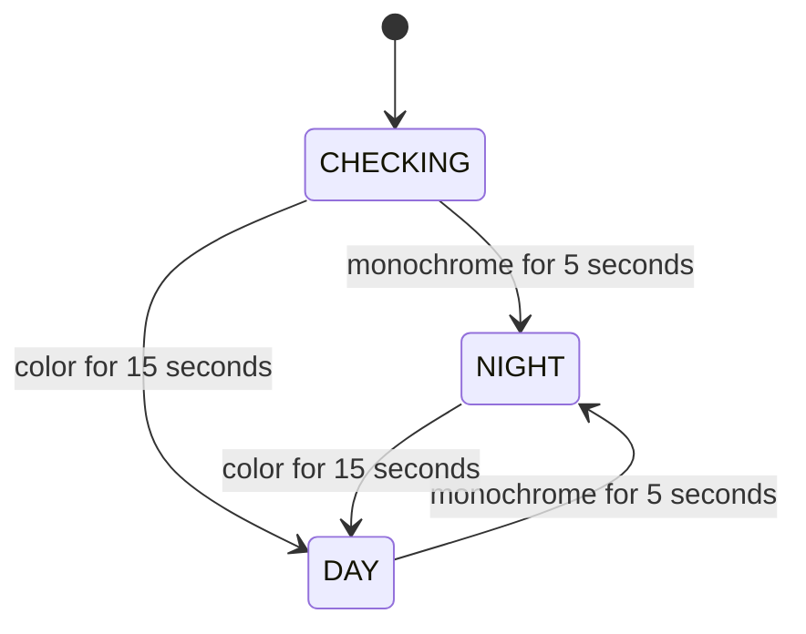

1. **How is actual camera night vision detected?** A once-per-second sample of the native camera image measures the 90th percentile of per-pixel BGR channel spread. The current native night image measured 0; the preserved daylight image measured 33.

2. **Explicit hardware state or fallback?** Image-derived fallback. No reliable day/night or IR-state control was exposed by this camera's V4L2 interface. The USB vendor extension has undocumented semantics; it was not guessed or written. This is a monochrome proxy, not direct telemetry from the IR-cut mechanism.

3. **Hysteresis?** Enter NIGHT after at least 5 seconds continuously at spread p90 <= 3. Resume DAY after at least 15 seconds continuously at p90 >= 8. Intermediate values reset confirmation and retain the current state. Startup/reconnected geometry begins CHECKING with processing paused. Duplicate/stale packets cannot advance confirmation; long sampling gaps reset it.

4. **Does NCNN inference stop completely at night?** Yes in the validated settled night state: 0 Hz and zero inference-thread CPU ticks. New submissions stop; pending references and results are cleared. A previously claimed call can finish, but its result is invalidated and cannot create a new trip. The worker sleeps while the same collector's lightweight image monitor remains active.

5. **Does automatic recording stop after existing sessions finalize?** Yes. The observer is gated before new confidence/zone evaluation and start/extension/evidence admission. Existing deadlines and queued frames finalize through the existing recorder. Once drained, its threads sleep, periodic disk scans stop, and unused pre-roll is cleared/disabled. Offline tests verified an existing exact-evidence session finished without extension or new PNGs. The real Pi had no active session at transition.

6. **Manual recording disabled?** Yes. The authenticated backend returns HTTP 409 with `night_mode_recording_paused`, and the dashboard disables Record 30 with a visible explanation. No override was added. An already accepted manual request keeps its existing bounded deadline; STOP can still clear it.

7. **Live preview available?** Yes. The final normal night sample measured 1.95 FPS; the actual browser showed the live image, existing red watch outline, night banner, and disabled recording control. No overlay reaches native pixels.

8. **Daytime operation resumes automatically?** Yes, without restart, after 15 seconds of stable color. The live Pi transitioned NIGHT -> DAY using a preserved daylight image for the monitor only; real NCNN resumed at 1.98 Hz. Returning the monitor to the actual night stream paused inference again. This proves the software return path; a natural physical dawn/IR-cut transition has not yet been observed.

9. **DAY versus NIGHT CPU/temperature?** Same-process bounded replay check: DAY processing 90.19% of one core, 176.81 MiB RSS, 71.09–73.04 C, 1.98 Hz. Subsequent NIGHT: 40.50%, 171.88 MiB, 72.55–73.52 C, 0 Hz. The final fresh normal NIGHT service: 36.82%, 92.21 MiB, 68.17–70.11 C, 0 Hz. Latest sealing spot reading: 71.1 C, `0xe0000`, no current throttle bits. Short samples are not thermal-equilibrium measurements.

10. **Exactly one collector running?** Yes. Normal service `squirrel-collector-phase4-6.service`, PID 9248, is the sole camera owner. Legacy service remains inactive/MainPID=0. The validation process exited and its workers stopped. No GPIO/I2C descriptors were found.

11. **Other runtime behavior changed?** No model, threshold, watch polygon, recording FPS, detector cadence, recording timeline/encoder architecture, trip-evidence contract, calibration, control, training or Golden changes. The only behavior additions are the collector night gate, idle waits/pre-roll suppression, and dashboard/API availability at night. Existing Phase 4.7 heat/long-session limitations remain.

# Phase 4.8 — Night-vision idle mode

Implemented, tested, and deployed in the isolated data collector. Source commit **`dffb8fec1309bd19b1f32756b136f137bf1d9e79`**, local branch `squirrel-runtime-v2`; not pushed. Worktree: `C:\dev\squirrel-squirter-runtime-v2`. Baseline: `b70ff67530b72c65c8e3c21c6954308c978f9633`. The pasted Phase 4.8 request and the owner's automatic-resumption clarification are authority. The Phase 4.7 handoff was read as evidence and its unresolved reliability limits remain in force.

## Camera discovery and fallback evidence

Actual camera: **HD USB Camera, USB 32e4:9230**, `uvcvideo`, native MJPG 1280x720. The known request/report mismatch remains: 15 FPS requested, device reports 60 FPS. No capture setting was changed. No second camera owner was opened for discovery.

`hardware_before.txt` records V4L2 device/control inventories, USB descriptors and initial processes. Exposed controls cover brightness, contrast, saturation, hue, white balance, gamma, gain, power-line frequency, sharpness, backlight, exposure and dynamic frame rate. None exposes the current IR/day/night state. `CameraConfig.ir_mode_if_explicitly_detected_or_configured` is a configuration label, not dynamic hardware telemetry, and cannot detect dawn.

The metadata node `/dev/video1` exposes `UVCH` (UVC payload header metadata). This format carries standard payload-header and timing information; it is not an exposed IR-cut status API. See the [Linux kernel UVC metadata documentation](https://docs.kernel.org/userspace-api/media/v4l/metafmt-uvc.html). An extension descriptor with GUID `28f03370-6311-4a2e-ba2c-6890eb334016` exists, but no reliable mapped night control or documented state encoding was established. No vendor control values were guessed and no writes were made.

At each sample, an immutable native frame is read through the existing camera owner. Strided sampling limits the input to at most 64x48 pixels (3072). For each sampled pixel, compute `max(B,G,R) - min(B,G,R)`, then take p90. There is no crop of detector input, new image classifier, motion model, time-of-day rule, or new monitoring thread. The existing latest-frame collection thread performs this small sample; while paused it sleeps for one second between checks.

The actual native IR image has **p90=0**. The preserved clean daylight frame has **p90=33**, comfortably beyond the day threshold. The old JPEG preview's p90 was 5 because presentation contains a red polygon/compression; it was only preliminary evidence. Production monitoring uses native pixels before all overlays, avoiding that contamination.

```yaml
collector_night:
  enabled: true
  sample_seconds: 1.0
  enter_seconds: 5.0
  exit_seconds: 15.0
  monochrome_p90: 3.0
  color_p90: 8.0
```

The collector-specific config is explicitly enabled in the isolated Pi YAML. Omission defaults to disabled for other existing configurations; the unrelated legacy `night_mode` implementation is not loaded or reused. Invalid thresholds, nonfinite values and invalid timing fail config validation.

**Fallback limits:** A naturally monochrome daylight scene, a covered lens or a camera configured to grayscale may remain paused. Unexpected colored artifacts in IR could falsely indicate day if sustained. This site's measured night/day samples separate well, but this is not hardware attestation. Darkness alone is not the test. Neutral/noisy transitions retain the prior confirmed mode until the opposite condition is stable; a new camera generation/shape rechecks state. No scheduled fallback or clock-based trigger was added.

## Transition and evidence behavior



CHECKING and NIGHT pause detector submission and manual admission. Entering the pause clears pending inference and the visible detector result and increments the worker revision, so an older in-flight result cannot reach the observer. A callback already completing before the pause is serialized with that transition; its previously admitted tail is allowed to finish. NCNN is not forcibly interrupted mid-call. Status exposes `paused`, `in_flight`, worker state, candidate, metric, sample count, transition count and thresholds.

The observer checks its paused state before zone/confidence processing and again before evidence/session admission. Manual API requests serialize against the same worker transition lock. The existing automatic tail and manual deadlines are retained, not renewed. No new source evidence is created in settled NIGHT. Existing evidence and media are retained untouched.

Recorder changes are limited to an idle request and wake events: after all sessions drain, the encoder skips its periodic storage scan and sleeps; the collection thread also sleeps. Starting day releases the idle request. The encoder/session/timestamp/queue architecture and bounds are unchanged. Pre-roll stays available while an existing session drains, then is cleared and disabled. On day resumption it refills at the existing rate; an immediate first trip can have less than the full two seconds of pre-roll. No missing pixels are invented.

The network/model may retain memory once first used. The lower RSS of the final fresh night service reflects a process that has not yet run inference; do not interpret that as guaranteed nightly model unloading. Camera capture/decoding still consumes CPU, as requested, even when nobody is viewing the preview. Shared JPEG preview work remains demand-driven.

## Tests and bounded Pi verification

**767 passed in 62.94 seconds**, zero failures or skips (`full.txt`, `full.xml`), compared with the 756-test Phase 4.7 baseline. Eleven additional test cases cover:

- Both transitions, separate thresholds/timers, ambiguous intervals and anti-flapping.
- Sample cadence, duplicate/stale input, gaps, generation reset and native pixel immutability.
- Configuration rejection, pending/in-flight cancellation and resumed inference.
- Night manual API rejection, observer rejection without zone diagnostics/PNG creation, working preview and dashboard indicator.
- Existing automatic tail finalization without new extension/evidence and idle storage-scan suppression/wakeup.

Existing collector, camera, recording, exact-trip, gallery, detector and forbidden-control construction tests remain passing. Run command: `python -m pytest -q --junitxml=<evidence>/full.xml` from the worktree.

The Pi check used one real camera/runtime and real NCNN. Its **only DAY simulation** supplied a preserved daytime frame to the night monitor; NCNN still received the current, unchanged native camera image. Automatic admission was disabled solely in that isolated validation config to avoid fabricated/irrelevant test trips and recording load. The normal deployed config retains automatic recording enabled at 0.02. No production override or test route was installed.

The test sequence was actual NIGHT -> bounded NIGHT sample -> stable DAY-monitor replay -> roughly ten seconds of actual NCNN work -> actual NIGHT -> bounded NIGHT sample. It passed the unchanged 78 C validation guard. Physical daylight could not be induced using a known reliable remote camera control, so no actual dawn claim is made. The complete script and results are preserved under the evidence root; the script is outside installed application source.

| Workload | Window | Process CPU, one core | Peak RSS | Temperature | Detector | Preview |
|---|---:|---:|---:|---:|---:|---:|
| Before patch, daytime processing policy on actual IR image | 10.23 s | 82.71% | 176.70 MiB | 75.47–77.91 C | 1.96 Hz | 2.05 FPS |
| NIGHT_INITIAL | 8.03 s | 39.23% | 100.20 MiB | 70.11–72.06 C | 0.00 Hz | 1.87 FPS |
| DAY_REPLAY | 10.09 s | 90.19% | 176.81 MiB | 71.09–73.04 C | 1.98 Hz | 1.88 FPS |
| NIGHT_RETURN | 10.12 s | 40.50% | 171.88 MiB | 72.55–73.52 C | 0.00 Hz | 1.98 FPS |
| Final normal NIGHT | 10.24 s | 36.82% | 92.21 MiB | 68.17–70.11 C | 0.00 Hz | 1.95 FPS |

The same-process DAY_REPLAY -> NIGHT_RETURN comparison reduced CPU about **55%**. Both recorded NIGHT windows had exactly **zero inference-thread CPU ticks**, zero clean-recorder collection/encoder ticks, and 0 Hz detector work. The lightweight monitor used one or two ticks per window. The live preview remained near 2 FPS. These are bounded measurements with retained per-thread snapshots, not sustained thermal claims. The camera's capture/decode work dominates the remaining night load.

The final normal service had automatic recording enabled but **zero inference calls since startup, zero qualifying trips, no active/pending recordings and zero pre-roll frames retained**. Stored field bytes stayed **788005953** across the sample. The authenticated night Record 30 request returned 409 again on the normal deployment. The actual browser showed the required banner, disabled button and populated historic gallery. The temporary browser viewer was closed afterward.


## Deployment and preservation

The previous collector was inactive with pending sessions zero before stop. Camera ownership was released before replacing the eight changed source/template files. The existing isolated config gained only `collector_night`; a parsed comparison verified all other keys unchanged. Historical source/config/receipt were saved to `phase4_8_before.tar` on the Pi and `source_before.tar` in the evidence root.

**88 protected files rehashed unchanged:** 79 field files, five model files and four legacy config/calibration/ledger/service files. All **74 installed source files** match their receipts and the source commit after line-ending normalization. No original field evidence was overwritten, repaired, relabeled or deleted. Owner `Misc/`, legacy checkout and all Phase 4.7 artifacts were excluded from modifications.

Source commit: `dffb8fec1309bd19b1f32756b136f137bf1d9e79`. Config SHA-256: `416b7d934c978bed0f9b8cfc9c69d037507764db118fa3b8ba7bc560c844e66a`. `final_audit.stdout` records all source hashes, preservation checks and active state. The installed receipt identifies 767 passed tests and the scope of live/replay validation.

| Changed deployed source | SHA-256 of installed bytes |
|---|---|
| src/squirrel_shooter/collector_night.py | `094fd609b42e07dc2cd2bb3b7c229a37418a8870140d498f9dd8c78fa07325ea` |
| src/squirrel_shooter/camera_service.py | `d4a7673e69e19d9b31050f8610d49a63417cd872db3d302d8ad02c5d947d30ff` |
| src/squirrel_shooter/collector_app.py | `f61f0d664fb79748329423837edd8650cb31076c3394d6d9cbcb5ee67486afa9` |
| src/squirrel_shooter/collector_policy.py | `b9bd9ef19e0c7cb9844fb6f52feb05c8a46f45e38438a34ec1154ad420d130fa` |
| src/squirrel_shooter/config.py | `d40afef7e44625b1f9004b060f87e8651b1bd7fae388009331b502bd41f5cd0b` |
| src/squirrel_shooter/inference_worker.py | `006ffd9ea0645634bb71314ea2ea73e269d9258240c13d4ab595f3bde8652751` |
| src/squirrel_shooter/recording.py | `d2e5d59c34af92c01b18c4a733738ec3e17bb0bd30d9a6d2e924b5b11628aa47` |
| src/squirrel_shooter/templates/collector.html | `12d175d82f1d99028580bd04cb458684652600d0469a13d8c493b6d7099d0ece` |

Final ownership: `systemd --user -> python PID 9248 -m squirrel_shooter.collector_app`. `/dev/video0` has only that owner. Legacy `squirrel-squirter.service` remains inactive/MainPID=0, no prohibited GPIO/I2C descriptors, and no validation process remains. Physical module checks were empty. The short read-only SSH audit process is separate and exits after collection.

Current dashboard: [Squirrel data collector](http://100.110.85.40:5094/).

SSH uses the same existing explicit key as prior passes:

```powershell
ssh -i C:\Users\swallace\.ssh\squirrel_pi_phase4_20260907 -o IdentitiesOnly=yes -o BatchMode=yes -o StrictHostKeyChecking=yes bslizzle8552@100.110.85.40
```

On the Pi, stop with `systemctl --user stop squirrel-collector-phase4-6.service`. For restart, confirm legacy inactive and camera unowned, then use the unchanged transient-unit start command in the Phase 4.7 handoff. No reboot/autostart policy was changed. Night/day transitions themselves never require a restart.

**Remaining limit:** The first natural dawn transition has not been witnessed. The software's automatic return path is tested with sustained daylight-image replay, and actual IR pause is verified live. This small pass reduces nighttime work; it does not close Phase 4.7 long-session/thermal acceptance or replace the cooling work planned for the weekend. No aiming, FIRE, hardware-control, model, training or Golden work occurred.
